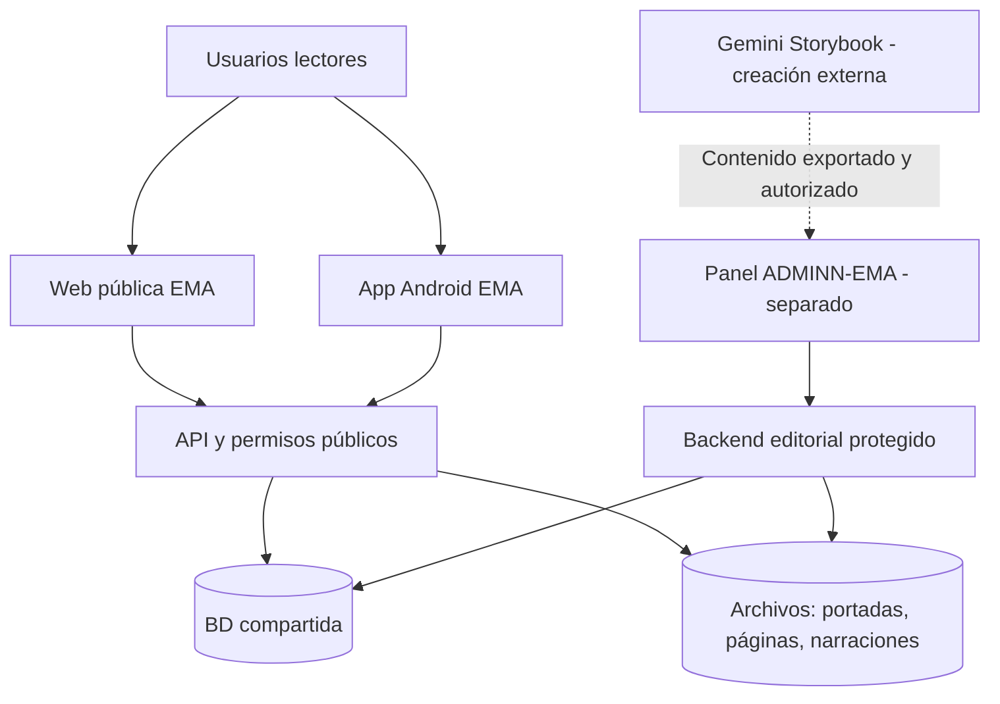

# EMA: Historias que Cobran Vida
## Plan maestro — web pública y aplicación Android

**Versión:** 2.0  
**Fecha:** 16 de octubre de 2026  
**Repositorio público:** [martin30eler-sketch/EMA](https://github.com/martin30eler-sketch/EMA)  
**Administración separada:** `martin30eler-sketch/ADMINN-EMA` (repositorio privado).

> **Decisión arquitectónica obligatoria:** este repositorio contiene exclusivamente la **web pública de lectura** y la **aplicación Android (APK/AAB)**. El panel de gestión se desarrolla, se despliega y se mantiene en el repositorio **ADMINN-EMA**. No crear rutas `/admin`, formularios de publicación ni lógica privilegiada de administración dentro de EMA.

## 1. Visión, marca y alcance

**EMA: Historias que Cobran Vida** es una biblioteca digital para **leer y escuchar** libros ilustrados o narrativos. Los usuarios pueden pasar las páginas con un efecto **Page Flip 3D** y reproducir narraciones sincronizadas.

- **Marca y nombre público:** EMA: Historias que Cobran Vida (30 caracteres; mismo nombre para web y APK).
- **Gemini Storybook:** herramienta **externa** para crear los libros, no plataforma para los lectores ni dependencia del visor público.
- **Publicación:** un administrador prepara y publica los libros mediante el **sistema ADMINN-EMA**, que no se incluye en este repositorio.
- **Contenido compartido:** un backend, base de datos y almacenamiento comunes abastecen a la web y la APK. Un libro publicado aparece en ambas sin actualizar la APK.
- **Estética:** editorial premium, cálida y mágica sin estilo cibernético.

### Decisiones pendientes antes del lanzamiento

Público objetivo y clasificación por edades; política de acceso gratuito/pago (los pagos no forman parte del MVP); dominio web; voz y licencia TTS; disponibilidad comercial de la marca; términos y política de privacidad. Proponer y validar estos elementos, sin bloquear el prototipo inicial.

## 2. Responsabilidades por repositorio

| Repositorio | Incluye | Excluye |
|---|---|---|
| **EMA** — público | Web pública, SEO, biblioteca, búsquedas, fichas, lector 3D, reproducción de audio, favoritos, cuentas, progreso, app Android, pruebas de usuario | Panel admin, endpoints de publicación, importador editorial, secretos de servicio, interfaz de edición de libros |
| **ADMINN-EMA** — privado | Panel editorial, importación, revisión, carga de archivos, generación/subida de narración, publicación, control de accesos y operaciones privilegiadas | Pantallas públicas de biblioteca, lector general y APK |

**Importante:** ambos consumen el mismo **contrato de contenido**, no el código fuente del otro. Desplegar cada uno de forma independiente (por ejemplo `ema.dominio` y `admin.dominio`) y proteger permisos reales en servidor, API, base de datos y almacenamiento. Un repositorio privado no sustituye la autenticación.

### Arquitectura



El código de `ADMINN-EMA` **no se empaqueta ni se importa** en la web o la APK. Los cambios del esquema/API se coordinan entre repositorios con contratos versionados y migraciones controladas.

## 3. Arquitectura técnica propuesta

| Capa | Elección inicial | Objetivo |
|---|---|---|
| Web pública | Next.js + React + TypeScript | Acceso desde navegador, SEO y lectura adaptable |
| App Android | React Native + Expo + TypeScript | App instalable, no mero acceso directo web |
| Base de datos | PostgreSQL / Supabase | Catálogo, cuentas y progreso compartidos |
| Autenticación lector | Supabase Auth | Inicio de sesión y sincronización voluntaria |
| Recursos | Storage privado/público según derechos + CDN | Imágenes y narración optimizadas |
| Lógica cliente compartida | Paquete de tipos/utilidades dentro de EMA | Estado del lector y contratos |
| API de contenidos | Capa de backend compartida y autorizada | Entrega de libros publicados |
| Animación | Motor Page Flip 3D web y renderer optimizado Android | Experiencia coherente sin comprometer fluidez |

**Seguridad:** claves públicas del SDK solo con acceso restringido mediante reglas efectivas; jamás incluir `service_role`, secretos TTS ni permisos administrativos en web/APK. El backend editorial privilegiado vive exclusivamente en `ADMINN-EMA` o infraestructura protegida asociada.

### Estructura objetivo de EMA

```text
EMA/
├── README.md
├── docs/
│   └── PLAN_MAESTRO_EMA.md
├── apps/
│   ├── web/                  # Web PÚBLICA de lectura, sin /admin
│   └── mobile/               # App Android / Expo
├── packages/
│   ├── reader/               # Contratos, estado y utilidades del lector
│   └── shared/               # Tipos públicos, validación y utilidades
├── tests/                    # Contratos y pruebas de experiencia
└── .github/workflows/        # CI de web y app
```

El árbol es **planificado**, todavía no implementado.

## 4. Proyecto A: web pública

### Pantallas y funcionalidades del MVP

1. **Inicio:** marca EMA, libros destacados, novedades, recomendaciones editoriales y continuar leyendo.
2. **Biblioteca:** portadas, categorías, filtros, búsqueda y paginación.
3. **Ficha del libro:** título, autor, descripción, género, idioma, vista previa, edad recomendada si procede y botón **Leer**.
4. **Lector interactivo:** páginas enfrentadas cuando el dispositivo lo permita, giro 3D con perspectiva, sombras y navegación atrás/adelante.
5. **Narración:** reproducir/pausar, velocidad y paso de página sincronizado cuando haya audio.
6. **Cuenta del lector:** favoritos e historial/progreso sincronizados; explorar títulos públicos sin registrarse.
7. **Accesibilidad:** modo de movimiento reducido, teclado, lectores de pantalla, contraste y controles visibles.
8. **Robustez:** estados de carga/error y optimización para redes móviles.

La web debe permitir **leer directamente**. No enviar al usuario al visor de Gemini ni exigir instalar Android.

## 5. Proyecto B: aplicación Android

### Funciones del MVP

- Biblioteca y ficha de libros conectadas al mismo catálogo de la web.
- Lector inmersivo con gesto/tap de cambio de página; animación 3D realista de derecha a izquierda e inversa.
- Narración por página o pista completa; pausar/reanudar, velocidad de reproducción y avance sincronizado.
- Favoritos y progreso vinculados a la cuenta, con reanudación entre web y APK.
- Caché prudente, cargas optimizadas, errores de red y accesibilidad con movimiento reducido.
- **APK** para pruebas; **AAB** firmado para publicación eventual en Google Play.
- Título de tienda: **EMA: Historias que Cobran Vida** (mantener 30 caracteres).
- El catálogo debe refrescar desde el backend sin distribuir una nueva versión binaria.

**Prototipo prioritario:** validar Page Flip en dispositivos Android reales de gama media con libro exportado de 8–12 páginas; probar memoria, FPS, gestos, cambio de orientación y sincronización con audio. Si un renderer nativo no logra calidad suficiente, evaluar un visor especializado dentro de una pantalla nativa, sin convertir toda la app en una web empaquetada.

## 6. Formato de libro y contrato compartido

El backend entrega solo **libros publicados y autorizados**. Modelo conceptual común (administrado por el sistema editorial, consumido por EMA):

- `books`: `id`, `slug`, `title`, `summary`, `author`, `cover`, `language`, `status`, `published_at`, `age_rating`.
- `pages`: `id`, `book_id`, `position`, `page_asset`, `reading_text`, `alt_text`, `layout`.
- `narrations`: `id`, `book_id`, `page_id`, `language`, `voice`, `audio_asset`, `duration_ms`.
- `narration_cues`: sincronización opcional para páginas/segmentos.
- `categories`, `book_categories`: clasificación y exploración.
- `profiles`, `favorites`, `reading_progress`: preferencias privadas de cada lector.

### Contratos/API mínimos

| Operación pública/autorizada | Uso |
|---|---|
| `GET /books` | Listar solo libros publicados con filtros |
| `GET /books/:slug` | Ficha de libro y páginas visibles |
| `GET /books/:id/assets` | Recursos de lectura/audio según reglas |
| `GET/PUT /me/progress/:bookId` | Progreso del usuario autenticado |
| `GET/POST/DELETE /me/favorites` | Favoritos del usuario |

Estos nombres son **orientativos**. El contrato definitivo se acordará con `ADMINN-EMA`, incluyendo versiones, estado de publicación y campos obligatorios. El servidor debe impedir la exposición de borradores y de ficheros privados.

## 7. Narración sincronizada

- El audio de Storybook **no se considera exportable automáticamente**. EMA reproduce audio suministrado legítimamente por el proceso editorial, no extrae audio del visor Gemini.
- En **modo lectura**, el usuario gira las páginas manualmente.
- En **modo escuchar**, la pista se reproduce y la página cambia al terminar su audio o al alcanzarse una marca de sincronización.
- El usuario puede pausar, cambiar la velocidad y navegar; hay que definir cómo se reanuda el audio al cambiar página manualmente.
- Una página sin audio es legible; el error de narración nunca bloquea la lectura.
- Resaltado palabra a palabra y descarga offline completa quedan fuera del MVP salvo disponer de metadatos y licencias adecuados.

## 8. Calidad, seguridad y cumplimiento

- Permisos y políticas de datos del lado servidor; aislar cuentas y progreso.
- No exponer claves privadas, rutas de administración ni documentos en borrador.
- Manejar derechos de autor de libros/ilustraciones/audios y datos personales.
- Validar requisitos de Google Play, incluido tratamiento de datos y público infantil si aplica.
- Pruebas web y Android con lectura real, audio y condiciones de red adversas.
- Métricas: apertura de libro, avance, tiempo de carga, errores de audio, tasa de finalización y rendimiento Page Flip.
- Definir alternativa estática para personas con sensibilidad al movimiento.

## 9. Etapas de desarrollo y entregables

| Etapa | EMA (web y Android) | Dependencia con ADMINN-EMA |
|---|---|---|
| 0. Diseño y contratos | Wireframes de web/app, prototipo Page Flip y esquema de datos | Validar formato común de libros |
| 1. Cimientos | Inicializar Next.js y Expo, autenticación de lectores, clientes API | Backend, storage y permisos disponibles |
| 2. Web MVP | Biblioteca, ficha y lector de páginas | Al menos un libro publicado desde panel |
| 3. Narración | Player, control de velocidad, cues y paso automático | Audio y metadatos cargados por panel |
| 4. Android MVP | Biblioteca, lector 3D, cuentas, favoritos y progreso | API compartida estable |
| 5. Lanzamiento | Tests, accesibilidad, SEO, APK pruebas, AAB para Play | Flujo editorial operando en producción |
| 6. Evolución | Offline, mejoras de experiencia, idiomas adicionales | Capacidad editorial incrementada |

### Criterios de aceptación del MVP conjunto

1. El administrador publica un libro en **ADMINN-EMA**.
2. El libro aparece sin pasos manuales en la **web pública EMA y la app Android EMA**.
3. Un usuario puede leer, girar páginas 3D y escuchar narración **dentro de EMA**, sin Gemini.
4. El avance y favoritos de usuarios autenticados se mantienen al cambiar de dispositivo.
5. La web y la APK no contienen panel administrativo ni secretos de publicación.
6. Los permisos impiden que usuarios públicos lean borradores o modifiquen el catálogo.

### Fuera de alcance del MVP

Generación de historias con IA dentro de EMA, funciones de red social, comentarios, pagos, marketplace, autores externos, recomendaciones algorítmicas avanzadas y lectura offline completa.

---

**Documento de planificación (v2).** Sustituye la versión que proponía una ruta `/admin` dentro de la web pública. El panel y las operaciones privilegiadas se planifican **únicamente** en el repositorio privado **ADMINN-EMA**.
