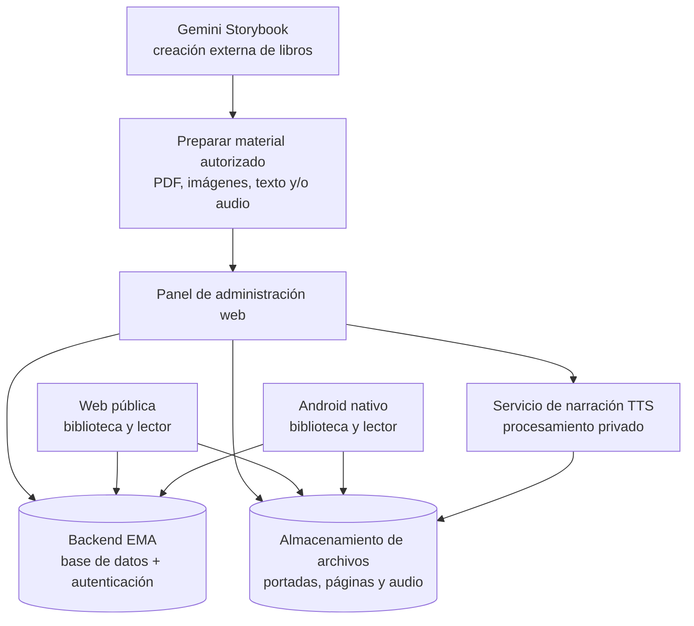

# EMA: Historias que Cobran Vida
## Plan maestro de la plataforma web y la aplicación Android

**Versión del documento:** 1.0  
**Fecha:** 16 de octubre de 2026  
**Repositorio:** [martin30eler-sketch/EMA](https://github.com/martin30eler-sketch/EMA)  
**Estado:** Planificación inicial; sin desarrollo implementado.

> **Visión:** EMA es una biblioteca digital en la que las historias se pueden leer, escuchar y disfrutar con ilustraciones y una animación realista al pasar las páginas. La web pública y la aplicación Android comparten catálogo, usuarios y contenido. Gemini Storybook se usa **solo como herramienta externa para crear los libros**; los lectores no necesitan entrar en Gemini.

---

## 1. Decisiones de producto ya definidas

1. **Marca única:** **EMA: Historias que Cobran Vida**, para web y app. El nombre tiene **30 caracteres**, incluido el espacio y los signos; conservarlo así permite respetar el límite de título de Google Play.
2. **Dos productos públicos:** sitio web de lectura y aplicación Android (APK para pruebas; AAB para publicar en Google Play).
3. **Un panel privado:** la persona administradora publica y administra libros desde la web.
4. **Una sola fuente de contenido:** web y Android consultan el mismo backend mediante API.
5. **Experiencia distintiva:** lector con efecto **Page Flip 3D**, audio narrado, controles de reproducción y avance de páginas.
6. **Libros creados fuera de EMA:** se preparan con Gemini Storybook y después se importan al sistema EMA, sin depender del visor de Gemini.
7. **Actualizaciones de catálogo:** publicar un libro en el panel lo hace disponible en web y app sin actualizar el binario de Android.

### 1.1 Alcance que falta decidir

- Público editorial: infantil, juvenil, adulto o catálogo mixto; esta decisión afecta clasificación por edad y controles de contenido.
- Modelo de acceso: catálogo gratuito, suscripción, compra individual o híbrido. **No implementar pagos en el MVP**.
- Dominio definitivo, registro de marca, identidad visual final y políticas editoriales.
- Proveedor de voz y presupuesto de generación/almacenamiento de audio.
- Idioma inicial recomendado: español; preparar estructura para más idiomas.

Estas decisiones no bloquean el prototipo técnico.

---

## 2. Arquitectura general



**Principio central:** la web y Android tienen interfaces adaptadas a cada dispositivo, pero comparten información, permisos y estados de publicación. La app Android será una aplicación instalable real, no únicamente un acceso directo a la web.

### 2.1 Propuesta tecnológica inicial

| Capa | Propuesta | Motivo |
|---|---|---|
| Web pública y administración | Next.js + React + TypeScript | SEO, rendimiento, panel y sitio público en el mismo proyecto web |
| App Android | React Native + Expo + TypeScript | Aplicación instalada, navegación móvil, compilación APK/AAB |
| Base de datos | PostgreSQL vía Supabase | Catálogo, usuarios, progreso y permisos |
| Autenticación | Supabase Auth | Acceso de lectores y administradores |
| Archivos | Supabase Storage inicialmente; CDN al escalar | Imágenes, portadas, páginas y narraciones |
| API / lógica privada | Endpoints del backend y funciones protegidas | Publicación, importación, TTS, validaciones |
| Lector animado | Motor de páginas 3D para web; componente/renderer optimizado en Android | Mantener el efecto visual y el desempeño |
| Monorepositorio | pnpm workspaces; paquetes compartidos | Tipos, validaciones y utilidades comunes |
| Pruebas | Vitest/Jest, pruebas de integración y E2E según plataforma | Estabilidad antes de lanzar |

**Decisión técnica a validar en prototipo:** la fidelidad del giro 3D en Android. Evaluar primero animación nativa; si no alcanza la calidad requerida, usar un visor de páginas especializado dentro de una pantalla nativa, **sin convertir toda la aplicación en una web empaquetada**.

### 2.2 Estructura propuesta del repositorio

```text
EMA/
├── README.md
├── docs/
│   ├── PLAN_MAESTRO_EMA.md
│   ├── ARQUITECTURA.md                 # a crear
│   ├── MODELO_DATOS.md                # a crear
│   └── GUIA_PUBLICACION_LIBROS.md     # a crear
├── apps/
│   ├── web/                           # Next.js: sitio público + /admin
│   └── mobile/                        # React Native / Expo: Android
├── packages/
│   ├── shared/                        # tipos, validaciones y lógica común
│   └── reader/                        # contratos y recursos del lector
├── supabase/                          # esquema, migraciones y políticas
└── .github/workflows/                  # pruebas y automatizaciones CI
```

La estructura es **objetivo de desarrollo**, no archivos existentes actualmente.

---

## 3. Proyecto A: página web pública + administración

### 3.1 Web para lectores

**Pantallas del MVP:**
- **Inicio:** portada editorial, destacados, novedades y acceso rápido a continuar leyendo.
- **Biblioteca:** cuadrícula de libros publicados con portadas, título, autor y categoría.
- **Explorar y buscar:** búsqueda por título/autor, filtros por género y etiquetas.
- **Ficha del libro:** sinopsis, portada, idioma, número de páginas, edad recomendada si aplica y botón **Leer**.
- **Lector:** libro abierto, páginas ilustradas, texto, navegación izquierda/derecha, cambio 3D, indicador de progreso y modo pantalla completa.
- **Modo escuchar:** reproducir, pausar, continuar, ajustar velocidad y elegir narración disponible; avance de página cuando corresponde.
- **Mi biblioteca:** favoritos, historial y continuar desde la última página, asociado a la cuenta.

**Diseño:** marca **EMA**, identidad editorial premium y magia sutil; contraste alto, tipografía legible, animaciones fluidas y diseño adaptable a móvil/tableta/escritorio.

**Acceso:** permitir explorar y probar libros públicos sin iniciar sesión; requerir cuenta para sincronización permanente de favoritos y progreso entre dispositivos. El usuario debe poder leer en web sin instalar Android.

### 3.2 Panel administrador (/admin)

Acceso privado con rol autorizado. Funciones por etapas:

| Función | MVP | Fase posterior |
|---|:---:|:---:|
| Iniciar sesión como administrador | ✓ | |
| Crear/editar ficha del libro | ✓ | |
| Subir portada y páginas ordenadas | ✓ | |
| Importar texto por página | ✓ | |
| Guardar borrador y vista previa | ✓ | |
| Publicar/despublicar libro | ✓ | |
| Subir narración por página | ✓ | |
| Asignar categorías, etiquetas y autor | ✓ | |
| Generar narración TTS desde el panel | Opcional* | ✓ |
| Estadísticas de lecturas | Básicas | Avanzadas |
| Programar publicaciones | | ✓ |
| Varios editores y revisión editorial | | ✓ |

`*` La prioridad es **reproducción confiable de audio**, aunque la generación automática desde el panel puede entrar tras validar costes, voz y calidad.

### 3.3 Flujo de publicación de un libro de Storybook

1. Crear la historia y las ilustraciones en **Gemini Storybook**.
2. Obtener el contenido por medios permitidos: exportación/impresión a PDF si está disponible; preparar imágenes de páginas y texto.
3. Comprobar **derechos de uso, atribuciones y condiciones de publicación** del material y de las voces/recursos empleados.
4. En el panel EMA, registrar título, autor, descripción, género, idioma y portada.
5. Importar páginas respetando **orden, orientación, imágenes y texto**. El importador puede ayudar a convertir un PDF, pero debe permitir **corrección manual**.
6. Subir audio narrado o generarlo mediante un sistema de voz propio autorizado. Registrar duración por página y, cuando sea posible, marcas de sincronización.
7. Revisar en **vista previa web y Android**: que la página gire bien, texto no se corte y narración coincida.
8. Publicar. El catálogo y los archivos quedan disponibles a través del backend común.

**Límite importante:** la narración del visor Gemini **no debe asumirse exportable o reutilizable automáticamente**. El plan contempla audio producido o subido legítimamente para EMA; no depende de extraer audio de una interfaz de terceros.

---

## 4. Proyecto B: aplicación Android (APK)

### 4.1 Funciones del MVP

- **Inicio y biblioteca:** catálogo sincronizado con el backend EMA.
- **Explorar:** categorías, búsqueda y ficha de cada libro.
- **Lector inmersivo:** ilustraciones y texto, transición **Page Flip 3D**, paso por toque o gesto, navegación anterior/siguiente y salto por páginas.
- **Narración:** reproducir/pausar, velocidad, estado visible y cambio automático de página cuando el audio termine o según marcas de sincronización.
- **Continuar leyendo:** reanudar exactamente donde se dejó; sincronización con web al iniciar sesión.
- **Favoritos:** marcar libros y sincronizar con la cuenta.
- **Accesibilidad:** tamaño de letra cuando la maquetación lo permita, etiquetas accesibles, controles grandes y alternativa sin movimiento 3D.
- **Estados de red:** indicador de carga, fallo, reconexión y caché local limitada.

### 4.2 Requisitos específicos de Android

- Distribuir **APK** para instalaciones de prueba y **AAB** para publicación en Google Play.
- El nombre visible será **EMA: Historias que Cobran Vida**; evitar añadir sufijos al título.
- No incluir claves privadas, credenciales de administración ni secretos TTS en la APK.
- Optimizar imágenes y audio para conexiones móviles; precargar la página siguiente.
- Permitir que un libro nuevo aparezca desde el servidor sin requerir nueva versión de la app.
- Manejar cierre de app, interrupciones de audio, bloqueo de pantalla y rotación.
- Notificaciones y descarga completa para lectura sin conexión: **etapas posteriores**, tras validar permisos, licencias, almacenamiento y experiencia.

### 4.3 Lector y animación 3D: criterios de aceptación

1. La página derecha gira hacia la izquierda y la anterior puede devolverse en sentido contrario.
2. Existen perspectiva y sombras que crean la sensación de hoja física.
3. Durante la animación no se superponen incorrectamente textos ni imágenes.
4. Funciona en distintos tamaños de pantalla, orientación vertical/horizontal y con gestos.
5. Se puede desactivar el movimiento por accesibilidad y usar transición simple.
6. **Meta inicial:** transición perceptualmente fluida en dispositivos Android de gama media; medir FPS y memoria en pruebas reales.
7. El audio puede continuar, pausarse o sincronizarse de forma predecible durante el giro.

**Prototipo obligatorio antes del desarrollo masivo:** probar con 1 libro de 8–12 páginas reales, 2 tipos de pantalla y 1 narración completa.

---

## 5. Contenido compartido: modelo de datos inicial

Entidades previstas:

- `users`: lector y roles.
- `profiles`: preferencias y datos mínimos de perfil.
- `books`: id, título, slug, sinopsis, autor, idioma, portada, estado, fecha de publicación, edad recomendada.
- `categories`, `book_categories`: clasificación.
- `pages`: id, book_id, número de orden, imagen/asset, texto alternativo, texto narrable, diseño y metadatos.
- `audio_tracks`: libro/página, idioma, voz, URL/asset, duración, origen autorizado, versión.
- `audio_cues`: marcas de tiempo para sincronizar segmentos y páginas, si están disponibles.
- `favorites`: relación usuario-libro.
- `reading_progress`: usuario, libro, última página, posición temporal y fecha de actualización.
- `assets`: tipo MIME, tamaño, ruta, dimensiones y trazabilidad de importación.
- `publishing_audit`: registro de quién publica o despublica.

**Regla:** los lectores solo reciben contenido **publicado**; borradores y archivos internos no son públicos. El backend debe aplicar permisos efectivos, no confiar en esconder botones en la interfaz.

### 5.1 API conceptual

| Operación | Propósito |
|---|---|
| `GET /books` | Listar libros publicados con filtros y paginación |
| `GET /books/:slug` | Obtener metadatos y páginas autorizadas |
| `GET /books/:id/reading-assets` | Entregar recursos de lectura/audio según permisos |
| `GET/PUT /me/progress/:bookId` | Consultar y guardar progreso del lector |
| `GET/POST/DELETE /me/favorites` | Administrar favoritos |
| `POST /admin/books` | Crear borrador desde el panel |
| `POST /admin/books/:id/publish` | Publicar tras validaciones |
| `POST /admin/imports` | Procesar archivos y preparar páginas |

Son **contratos propuestos**; las rutas definitivas se formalizarán al implementar.

---

## 6. Voz y sincronización del libro

### Modo manual

El lector toca **Siguiente** o **Anterior** para girar las páginas. Puede escuchar la narración de la página actual cuando exista.

### Modo narrado

1. La app reproduce el audio del libro o de cada página.
2. El sistema conoce la duración y, preferiblemente, marcas de sincronización.
3. Cuando termina la narración de una página, ejecuta la animación y continúa el audio de la siguiente.
4. El lector puede pausar, avanzar, retroceder y regular la velocidad.
5. Si no hay audio, el libro sigue funcionando en modo lectura.

**Nota técnica:** la duración por página permite sincronización básica; el resaltado palabra a palabra requiere marcas temporales adicionales. No prometer este resaltado en el MVP sin datos suficientes.

### Generación de voz

- Priorizar audio de calidad natural y pronunciación adecuada del español.
- Realizar generación en procesos del servidor, nunca exponer credenciales al cliente.
- Guardar el audio resultante y servirlo mediante almacenamiento/CDN; evitar generar voz en cada reproducción.
- Establecer presupuesto, límites y procedimiento de revisión humana del audio.
- Respetar las licencias y condiciones del proveedor TTS.

---

## 7. Experiencia de usuario y diseño

**Dirección visual:** editorial elegante, cálida y con magia discreta; no interfaz cibernética. Paleta inicial sugerida: verde oscuro, marfil y dorado suave, pendiente de aprobar.

### Viajes principales

**Lector nuevo:** abre web o app → explora biblioteca → entra a un libro → lee o escucha → guarda favorito/retoma lectura.

**Administrador:** entra al panel → crea borrador → carga páginas y portada → adjunta audio → previsualiza → publica → verifica el libro en web y Android.

### Estados que no deben faltar

- Biblioteca vacía; búsqueda sin resultados.
- Libro en preparación/borrador (solo admin).
- Narración no disponible.
- Conexión lenta o perdida.
- Archivo dañado/no compatible.
- Cuenta cerrada y reanudación de lectura.

---

## 8. Seguridad, contenido y cumplimiento

- Autenticación, roles y políticas de acceso a datos (incluidas políticas a nivel de fila cuando aplique).
- Validar tipo/tamaño de archivos; procesar PDFs e imágenes en un entorno seguro.
- No publicar tokens, secretos ni claves de servicio en código cliente o repositorio.
- Minimizar datos personales; definir retención, borrado de cuenta, privacidad y términos.
- Evitar atribuir erróneamente a Gemini funcionalidades que pertenecen a EMA; **EMA es un producto independiente**.
- Confirmar licencias y derechos de las historias, ilustraciones, voces y material exportado de servicios externos.
- Cumplir los requisitos de Google Play aplicables, especialmente si el producto se dirige a menores.
- Accesibilidad: texto alternativo, navegación por teclado en web, controles perceptibles y movimiento reducido.

---

## 9. Plan de ejecución por fases

| Fase | Web / administración | Android | Entregable verificable |
|---|---|---|---|
| **0. Base y diseño** | Identidad, wireframes, arquitectura y esquema | Flujos móviles, prueba técnica del Page Flip | Diseño navegable y prototipo 3D |
| **1. Backend compartido** | Catálogo, almacenamiento, roles y API | Configuración del proyecto y conexión al backend | Un libro de prueba accesible por API |
| **2. Web MVP** | Inicio, catálogo, ficha, lector y panel de publicación | Pantallas base | Web pública con libro publicado y lector funcional |
| **3. Narración** | Subir/servir audio, controles y vista previa | Reproductor y sincronización | Libro narrado sincronizado en web y Android |
| **4. Android MVP** | Ajustes por pruebas reales | Biblioteca, lector 3D, audio, progreso y favoritos | APK de pruebas conectada al mismo catálogo |
| **5. Calidad y lanzamiento** | SEO, accesibilidad, rendimiento y políticas | Pruebas en dispositivos, firma, AAB y ficha de tienda | Web publicada + app preparada para revisión de Google Play |
| **6. Evolución** | Analítica, editor avanzado, idiomas | Offline, notificaciones, mejoras del lector | Mejoras basadas en uso real |

Las fases son **orden de trabajo**, no fechas prometidas. La publicación en Play Store está sujeta a requisitos y revisión externos.

### 9.1 Alcance mínimo del MVP

Para considerar que EMA está lista para una primera prueba con lectores, debe existir:

- Una web pública con catálogo, ficha y lectura real.
- Panel de administrador seguro para subir y publicar al menos un libro completo.
- Un backend único para web y Android.
- Una app Android instalable con el mismo libro.
- Page Flip 3D usable en ambas experiencias, con alternativa accesible.
- Narración reproducible con avance de página sincronizado.
- Guardado básico de progreso y favoritos para usuarios autenticados.
- Manejo razonable de errores y ausencia de claves secretas expuestas.

### 9.2 No incluido en la primera versión

Red social, comentarios, seguidores, chat, creación automática de libros dentro de EMA, comercio electrónico, sistema de suscripciones, recomendaciones de IA complejas, traducción automática, publicación de libros por cualquier usuario y descargas offline completas. Estas funciones pueden evaluarse más adelante; no son requisitos de lanzamiento.

---

## 10. Calidad, pruebas y criterios de éxito

**Pruebas funcionales**
- Publicar, editar y despublicar un libro desde el panel.
- Ver el mismo catálogo actualizado en web y Android.
- Avanzar y retroceder páginas con animación sin contenido cortado.
- Reproducir, pausar y retomar el audio sin perder la página.
- Cambiar de dispositivo y recuperar progreso de una cuenta.
- Comprobar que lectores anónimos no ven borradores ni recursos privados.

**Pruebas no funcionales**
- Rendimiento con imágenes y audios reales; compresión, carga progresiva y caché.
- Accesibilidad web, lector sin animación y claridad de controles.
- Múltiples tamaños de pantallas Android, navegadores principales y conexiones lentas.
- Seguridad de carga de archivos, roles y datos personales.
- Protección ante costes inesperados de TTS, almacenamiento y transferencia.

**Indicadores iniciales**
- Porcentaje de libros publicados sin errores de importación.
- Tasa de apertura de libros desde la biblioteca.
- Tasa de finalización de lectura/escucha.
- Fallos del lector, latencia de carga y errores de reproducción.
- Uso de lectura manual frente a modo narrado.

---

## 11. Riesgos y cómo mitigarlos

| Riesgo | Medida |
|---|---|
| El PDF de origen no conserva texto estructurado o calidad suficiente | Editor de corrección por página; importación asistida + revisión humana |
| Audio de Storybook no disponible como archivo independiente | Generar o subir narración autorizada específicamente para EMA |
| Page Flip 3D consume demasiados recursos | Prototipo temprano, optimización y modo reducido |
| Desfase entre audio y animación | Audio por página y metadatos temporales; pruebas de pausa y saltos |
| Costos de audio/archivos al aumentar usuarios | Cachear audios, formatos eficientes, límites y métricas |
| Problemas de derechos o contenido | Flujo editorial de verificación antes de publicar |
| Retrasos en revisión de Google Play | Preparar políticas, metadatos y compilación AAB con anticipación |

---

## 12. Primer ciclo de trabajo recomendado

1. Crear el monorepositorio con `apps/web`, `apps/mobile`, `packages/shared` y configuración básica.
2. Diseñar las pantallas de biblioteca, ficha, lector y panel admin (web y Android).
3. Construir **primero el prototipo de pasar páginas 3D** con un libro real exportado de Storybook; validar el caso más distintivo antes de ampliar funcionalidades.
4. Implementar el modelo de libro por páginas, almacenamiento y API compartidos.
5. Conectar la web al catálogo, publicar el primer libro y adjuntar narración.
6. Conectar Android al mismo backend y probar lectura, audio y sincronización.
7. Ejecutar pruebas de usabilidad y definir la primera versión pública.

## 13. Definición de terminado para la primera entrega

Una persona administradora puede crear un libro en Gemini Storybook, preparar/exportar legalmente su contenido, cargarlo y publicarlo en EMA. Un lector puede encontrar ese libro **en la web pública y en Android**, abrirlo **sin entrar en Gemini**, pasar páginas con una animación convincente, escuchar una narración sincronizada y continuar su lectura. Ambos productos muestran el contenido del mismo sistema.

---

**Documento de planificación.** No representa funcionalidades construidas ni aprobaciones de proveedores. Cambios de alcance y decisiones de implementación se registrarán aquí antes de iniciar cada fase.
